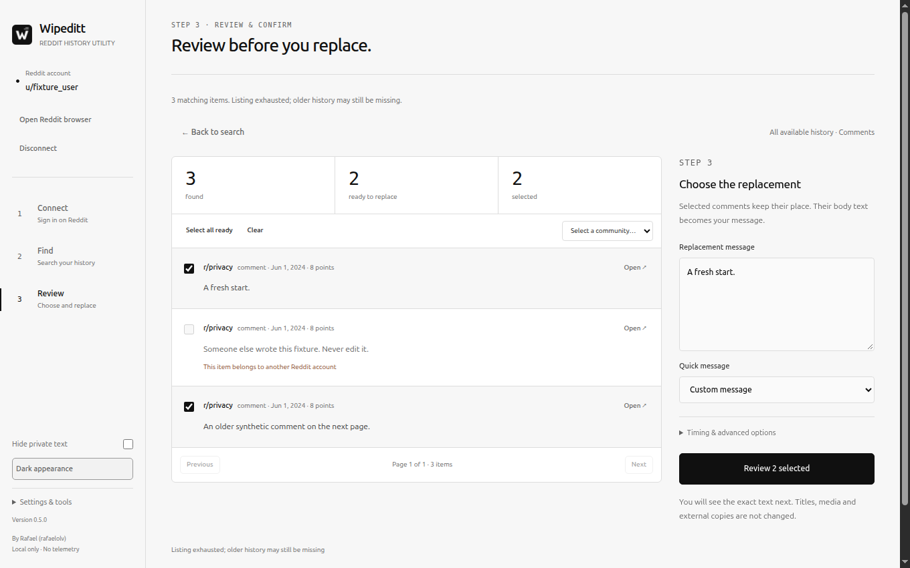

<p align="center">
  
</p>

<p align="center">
  <a href="https://github.com/rafelolv/Wipeditt/releases/latest"></a>
  <a href="https://github.com/rafelolv/Wipeditt/actions/workflows/ci.yml"></a>
  <a href="LICENSE"></a>
  <a href="https://www.electronjs.org/"></a>
</p>

<p align="center">
  <strong>Your Reddit history. Your control.</strong><br>
  Find, review and replace your own comments and text posts — locally, with a desktop app.<br>
  Choose what to change. Nothing happens until you confirm.
</p>

<p align="center">
  <a href="#install">Install</a> &nbsp;·&nbsp;
  <a href="#quick-start">Quick start</a> &nbsp;·&nbsp;
  <a href="#features">Features</a> &nbsp;·&nbsp;
  <a href="docs/USER-GUIDE.md">User guide</a> &nbsp;·&nbsp;
  <a href="https://github.com/rafelolv/Wipeditt/releases">All releases</a> &nbsp;·&nbsp;
  <a href="https://github.com/rafelolv/Wipeditt/issues">Get help</a>
</p>

> [!WARNING]
> **Replacing text can be permanent.** Wipeditt changes your own Reddit content through the website's own forms. There is no undo, and external copies can remain. Start with a small selection and read the exact replacement before confirming.

## What Wipeditt is for

Wipeditt is a local desktop app for cleaning up **your own Reddit comments and text posts**. When a cleanup would mean opening years of threads one by one, Wipeditt scans the history Reddit makes available, applies your filters and lets you review every match before anything is changed.

| Where | When Wipeditt helps |
| --- | --- |
| **Old comments** | Find comments by community, date, score or text, then replace the bodies you no longer want to keep. |
| **Text posts** | Replace the body of your own self posts while leaving titles and links untouched. |
| **A specific community** | Filter to one subreddit, review the matches, and select a whole community at once. |
| **Older history** | Import `comments.csv` from Reddit's official data export when live listings stop before your oldest comments. |

Wipeditt replaces **body text**; it does not delete live content. Link posts, titles, media and other people's content are outside the live workflow. Deletion and replace-then-delete are available only in the clearly labeled sample mode until independently validated.

> [!TIP]
> Cleaning up Telegram too? **[Also check Wipegram](https://github.com/rafelolv/Wipegram)** — the same review-first approach for your own messages.

## Install

### Choose your package

| 🐧 Linux · AppImage | 🐧 Linux · Debian | 🪟 Windows | 🍎 macOS |
| --- | --- | --- | --- |
| [Download AppImage](https://github.com/rafelolv/Wipeditt/releases/latest) | [Download `.deb`](https://github.com/rafelolv/Wipeditt/releases/latest) | [Download installer](https://github.com/rafelolv/Wipeditt/releases/latest) | [Download `.dmg`](https://github.com/rafelolv/Wipeditt/releases/latest) |
| Mark executable, then open. | Install with your package manager or software center. | Run the installer. | Choose Apple Silicon or Intel from the release. |
| No install required. | Integrates with the desktop. | Per-user install. | Drag Wipeditt to Applications. |

Packages are unsigned; macOS builds are not notarized. Verify downloads against the release's `SHA256SUMS`. Windows SmartScreen and macOS Gatekeeper may ask you to confirm the app manually. Linux AppImage may need `chmod +x Wipeditt-*.AppImage`; if FUSE is unavailable, run it with `--appimage-extract-and-run`.

### Ready in four steps

1. **Download and open Wipeditt** from [Releases](https://github.com/rafelolv/Wipeditt/releases/latest).
2. **Choose Connect Reddit** and sign in on Reddit's own page inside the app. Wipeditt verifies the account automatically; **Verify account** remains available as a fallback. No Client ID, developer app or API key is needed.
3. **Choose what to find** — comments, text posts or both — and add optional filters. Press **Find my comments**.
4. **Review every match**, select what you approve, enter the replacement, then confirm the exact text. Above 100 selected items, type `ANONYMIZE`.

Session memory is off by default. Enable **Keep me signed in on this device** before connecting only if you want Wipeditt's own Reddit session to persist. Disconnect clears the app-owned session and does not touch your normal browser.

<details>
<summary><strong>🛠 Prefer building from source?</strong></summary>

Node.js 24+ and npm are required. Native Electron GUI dependencies and a graphical session are required on Linux.

```bash
npm ci --ignore-scripts
npm run setup
npm start
```

`setup` explicitly downloads the locked Electron runtime. Build outputs live in ignored `app/` and `dist/`. See [development](#development) for checks and source layout.

</details>

## A peek inside


| ☀️ Light mode | 🌙 Dark mode |
| :---: | :---: |
|  |  |
| Review matches and choose a replacement. | The same workspace at night. |

Screenshots use synthetic fixture data. They do not show a real account, and they do not prove that a live edit will succeed.

## Features

| | Made for your cleanup |
| --- | --- |
| 🔎 **Find what matters** | Comments, text posts or both. Filter by community, date, score, text, regex and edited status. |
| 📚 **Reach older history** | Import `comments.csv` from Reddit's official data export. The file stays on your computer. |
| 👀 **Preview first** | Browse every result in pages. Select individual rows, checkboxes, all ready items or a whole community. |
| 🛡️ **Keep control** | Verify the account and author, reload the original before each write, and show the exact replacement. |
| ⏳ **Respect the pace** | A serial scheduler, configurable delay, bounded retries, Pause and Stop. |
| 🫥 **Keep it private** | Blur names and previews with privacy mode. No telemetry, no remote logging, no app backend. |
| ✨ **Feel at home** | Warm light theme, full dark theme, a finished summary and a local JSON report. |

**No Reddit password collection. No cookie export. No private endpoint replay.** Wipeditt operates Reddit's visible website forms using the session you create in the app.

## Quick start

1. Connect Reddit and sign in on Reddit's page. Verification runs automatically when login finishes.
2. Choose **Comments**, **Text posts** or **Comments & text posts**.
3. Optionally expand **Filter by community, date or text** and narrow the search.
4. Press **Find my comments**. This stage is read-only.
5. Review the counts, snippets and eligibility. Open an original when you need context.
6. Select individual items, **Select all ready**, or pick a community. Use **Clear** to start over.
7. Enter the replacement message or choose a quick message.
8. Press **Review changes**, read the exact text, and confirm.
9. Use **Pause** or **Stop** if you change your mind. Submitted writes may finish; Wipeditt never replays an uncertain write.

The review view shows 10 items per page. Selection is kept across pages, and the selected total updates immediately.

## What is supported

| Target | Support |
| --- | --- |
| Your comments | ✅ Replace editable body text |
| Your text posts (self posts) | ✅ Replace editable body text |
| Post titles | ❌ Not changed |
| Link, image and video posts | ❌ Not eligible for body replacement |
| Other authors' content | ❌ Blocked by ownership checks |
| Live deletion | ❌ Disabled pending independent validation |
| Replace-then-delete / delete | ✅ Sample mode only |
| Reddit data-export import | ✅ `comments.csv` |
| Older comments missing from live pages | ⚠️ Import the official export |
| External copies, quotes, archives | ❌ Cannot be removed |

### Comments, posts and scope

Wipeditt's live scan follows every page Reddit's classic history listing makes available. **There is no app-imposed item cap** — the old "Maximum items" setting is gone. Reddit can still stop a listing early, hide entries, or omit content that is too old or no longer accessible, so a finished scan is not proof of complete account coverage.

Live mode replaces the body of editable comments and text posts. It cannot change titles, link targets, media or another user's content. When an item is no longer editable, its author does not match, or the current text has changed, that item is skipped before any write.

### Older history and Reddit exports

Reddit's live pages may stop before your oldest comments. For broader coverage:

1. Request your data from [Reddit's data request page](https://www.reddit.com/settings/data-request) — Wipeditt also links to it from **How to get it**.
2. Download the archive Reddit provides and open it.
3. In Wipeditt, choose **Import comments.csv** and select the file.

The CSV is read locally by the main process; it is never uploaded. Wipeditt keeps only comments that belong to the verified account, skips `[deleted]`, `[removed]`, malformed and duplicate rows, and applies the same filters as a live scan. Import is a snapshot: if a comment was edited or deleted on Reddit since the export, Wipeditt skips it during the pre-write check. Import covers comments, not text posts.

## Filters

| Filter | Behavior |
| --- | --- |
| **Content type** | Comments, text posts, or both. Import is comments-only. |
| **Include subreddits** | Comma-separated communities to keep. |
| **Exclude subreddits** | Comma-separated communities to leave out. |
| **Text contains** | Case-insensitive local match on the visible body. |
| **Regular expression** | JavaScript regex, checked locally. Invalid patterns are rejected before scanning. |
| **From / Until** | Local date and time bounds. Both ends are inclusive. |
| **Minimum / maximum score** | Keep comments within a score range. |
| **Edited status** | Any, edited or unedited. |

Filters apply to both live scans and imported comments. Changing a filter after a scan requires a fresh scan; changing selection, replacement or timing invalidates the pending confirmation.

## Safety model

Wipeditt is deliberately conservative:

- **Only the verified account.** The account is bound to the preview and checked again before every write. Switching accounts invalidates the review.
- **Nothing changes during a scan.** Discovery is read-only. Selection and replacement are previewed before the first write.
- **Every write is rechecked on a fresh page.** Wipeditt reloads the original item, verifies account, author and current text, then uses Reddit's own edit form.
- **The exact text is shown before confirmation.** Confirmation expires after five minutes. Canceling or closing the dialog authorizes nothing.
- **Above 100 selected items, type `ANONYMIZE`.** The extra phrase prevents accidental bulk confirmation.
- **Stop prevents new requests.** A request already submitted may still finish. Ambiguous writes become uncertain and are never automatically replayed.
- **Deletion is disabled for real accounts.** Sample mode exists to explore the workflow; it is always labeled and never touches Reddit.
- **No cookie, password or token extraction.** The app never reads your system browser profile and does not bypass Reddit's authentication, permissions or CAPTCHAs.

Replacing text does not remove quoted replies, search caches, archives, moderation records, backups or other people's copies. There is no erasure guarantee.

## Rate limits and retries

- One serial scheduler owns reads and navigations; a stricter cooldown from the server wins over the selected delay.
- The default minimum interval between live actions is 1.5 seconds and can be increased in **Timing & advanced options**.
- Safe reads may be retried with bounded backoff. Submitted writes are not retried when the result is ambiguous.
- Pause takes effect at a request boundary. Stop prevents new work and leaves a partial report.
- Reddit can throttle or restrict an account at any time. Wipeditt does not bypass those limits. If a listing stops unexpectedly, wait and try a smaller selection later.

## Report format

<details>
<summary><strong>📄 What the JSON report contains</strong></summary>

The **Save report** action opens a native save dialog and writes a local JSON file containing:

- app version and export time,
- simulation flag and source (`live` or `import`),
- operation, elapsed time, stopped state and rate statistics,
- filter presence flags — not the private filter values,
- per-item content IDs, statuses and error codes.

Reports omit original text, usernames and sensitive filter values. IDs and statuses can still be identifying, so treat a report as private data. It is never uploaded by Wipeditt.

</details>

## Privacy

- No analytics, telemetry, remote configuration, runtime CDN or remote fonts.
- No application backend. The local shell uses bundled assets and a restrictive Content Security Policy.
- Reddit pages run in an isolated app-owned session with sandboxing, context isolation, no Node access and no privileged bridge.
- Remember session is opt-in. Disconnect clears only Wipeditt's own session. It does not sign out your normal browser.
- The imported `comments.csv` is read in the main process and never sent to a Wipeditt service.
- Theme and privacy preferences are stored in local `localStorage` as simple flags.
- Checkpoints contain expiring content IDs and statuses only; reports omit original text and names.

Read the [privacy details](docs/PRIVACY.md) for the complete data-flow description.

## Troubleshooting

| Problem | What to try |
| --- | --- |
| Reddit login does not complete | Use **Open Reddit browser** and finish Reddit's own sign-in flow. Wipeditt normally verifies automatically; choose **Verify account** if it does not. Reddit may require additional verification. |
| “Verify account” fails | Make sure the page shows your account, then choose **Verify account** again or reconnect. A preview from another account is invalid. |
| No old comments appear | Reddit listings are partial. Import `comments.csv` from your official export. |
| The import is rejected | Choose the `comments.csv` file from Reddit's archive, not another CSV. The file must include the standard export columns and be under 64 MB. |
| A scan stops early | Wait for any rate-limit cooldown, try a smaller selection, and keep the activity details for a bug report. |
| A write is uncertain | Inspect the original on Reddit, then obtain a fresh preview. Do not assume the edit failed, and do not retry blindly. |
| macOS refuses to open the app | Packages are unsigned and not notarized. Use **Open** from the context menu or allow the app in **System Settings → Privacy & Security**. |
| Linux AppImage does not start | Run `chmod +x` on the file. If FUSE is missing, use `--appimage-extract-and-run`. |
| Why can't I delete live content? | Live deletion has not been independently validated. Only text replacement is enabled for real accounts. |

When reporting a problem, include the Wipeditt version, operating system, the workflow you used, the exact error code and screenshots with private data removed. Never share passwords, cookies, session tokens or original private comment text.

## Development

<details>
<summary><strong>🧰 Setup, commands and source layout</strong></summary>

Requirements: Node.js 24 or newer and npm. Linux GUI tests need a graphical session or Xvfb.

```bash
npm ci --ignore-scripts
npm run setup
npm test          # deterministic unit tests
npm run check     # syntax, restricted APIs, tests, build and desktop checks
npm run test:ui   # real Electron runtime against synthetic HTTPS fixtures
npm start         # build and launch
npm run package   # native installer for the host platform
```

For headless Linux UI tests use `xvfb-run -a npm run test:ui`. The UI test creates a fresh temporary profile and serves synthetic Reddit pages through an isolated HTTPS protocol handler; no real Reddit account or network is used. Set `WIPEDITT_TEST_SCREENSHOTS=1` to refresh the screenshots in `artifacts/`.

### Source layout

| Path | Purpose |
| --- | --- |
| `src/desktop/main.js` | Electron windows, isolated sessions, IPC validation and file dialogs |
| `src/desktop/controller.js` | Main-process state, confirmation, engine ownership and commands |
| `src/desktop/renderer.js` | Local UI, selection, pagination, import and theme preferences |
| `src/desktop/index.html`, `app.css` | Trusted UI structure and the light/dark visual system |
| `src/desktop/reddit-browser.js` | Native scheduler, navigation and DOM bridge |
| `src/desktop/import.js` | RFC 4180 CSV parsing and Reddit export mapping |
| `src/engine.js` | Scan/import/execute orchestration and verification |
| `src/filters.js` | Filter normalization and local matching |
| `build/` | Bundling, icons, native packaging and source checks |
| `test/` | Unit tests and the Electron fixture test |

`app/` and `dist/` are generated and ignored. Do not edit them directly.

</details>

## License and creator

Created by **Rafael (rafaelolv)**. Original Wipeditt material is proprietary; [LICENSE](LICENSE) governs the code, documentation and artwork. Official unmodified packages are permitted for personal, non-commercial use. Modification, redistribution, commercial use and derivative software require prior written permission. Third-party components retain their independent licenses; see [third-party notices](docs/THIRD-PARTY.md) and [licensing details](docs/LICENSING.md).

## Contributing

Read [contributor guidance](CONTRIBUTING.md), [agent rules](AGENTS.md), [maintenance](docs/MAINTENANCE.md) and [release preparation](docs/RELEASING.md). Bug reports are welcome. Code changes to covered proprietary material require prior written permission from the creator.

Useful reports include:

- Wipeditt version and operating system,
- the exact workflow (scan, import, review or confirmation),
- the error code shown in **Search details & activity**,
- screenshots with usernames and comment text removed.

Do not paste passwords, cookies, tokens, account identifiers or private comment contents into issues.

---

<p align="center">
  <strong>A little less history. A fresh start.</strong><br>
  <a href="https://github.com/rafelolv/Wipeditt/releases/latest">Download Wipeditt</a> ·
  <a href="docs/USER-GUIDE.md">User guide</a> ·
  <a href="CHANGELOG.md">Changelog</a> ·
  <a href="LICENSE">Proprietary license</a>
</p>

<p align="center">
  <sub>Created by <a href="https://github.com/rafelolv">Rafael (rafaelolv)</a>. Reddit is a trademark of Reddit, Inc.<br>Wipeditt is independent and is not endorsed by or affiliated with Reddit.</sub>
</p>
