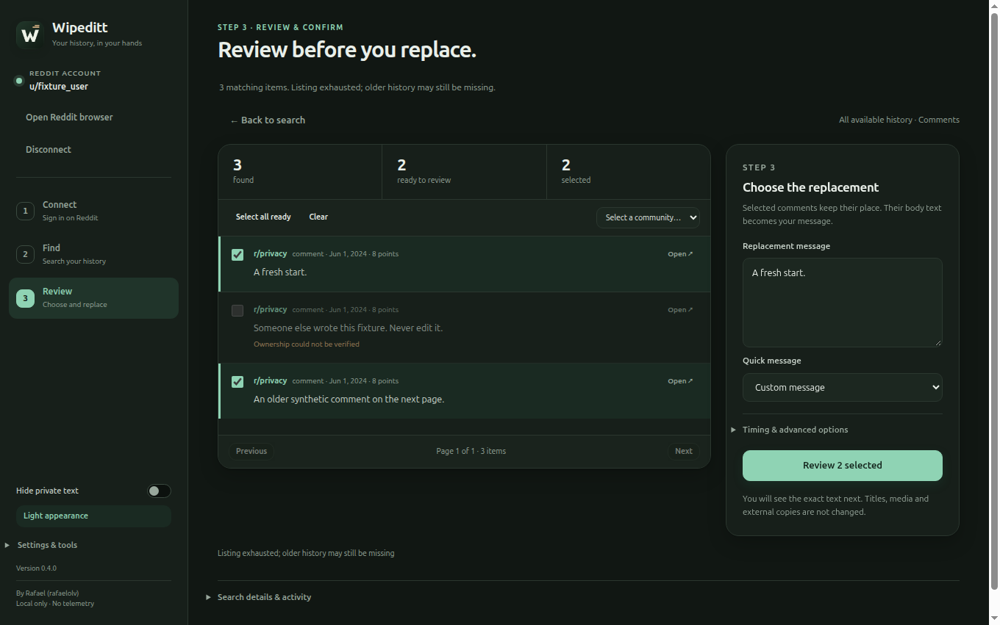

<p align="center"></p>

# Wipeditt

A local desktop app for reviewing and processing your own Reddit comments and posts. Created by **Rafael (rafaelolv)**. Current source, documentation and artwork are **GPL-3.0-only**; see [LICENSE](LICENSE) and [NOTICE](NOTICE).



## Three operations

| Mode | Behavior | Eligibility |
| --- | --- | --- |
| Anonymize | Replace body text and verify it after a fresh read. | Owned editable comments and text posts. |
| Delete | Use Reddit's native delete action and confirmation, then independently verify the original's deleted state. | Owned comments/posts with a native delete control, including non-editable posts. |
| Anonymize & Delete | Verify the replacement first, then independently recheck ownership and delete. | Owned items supporting both actions. Never falls back to deletion when editing fails. |

All three modes are enabled in official builds after maintainer-confirmed live anonymization/deletion and release approval. The detailed live post/interruption matrix remains incomplete; see [the evidence and remaining checks](docs/DELETION-VALIDATION.md). Automated fixtures are kept for development; production has no sample-data mode.

A failed delete after verified anonymization is reported as partial. An ambiguous submitted action is uncertain and is never replayed automatically. Isolated verification failures are left for review while the confirmed batch continues; account/permission changes, an outstanding native request and exhausted connection recovery still stop the batch. Stop prevents new actions; submitted actions may finish. Neither operation can erase external copies, caches, archives or quotations.

## Install and use

Official packages support **Linux x64** (AppImage/deb) and **Windows x64** (installer). **macOS and ARM are no longer supported or built.** Older releases retain their historical packages and licenses.

Download from [Releases](https://github.com/rafelolv/Wipeditt/releases) and verify `SHA256SUMS`. Packages are unsigned. Corresponding source and build scripts accompany each release in its source ZIP; [repository source](https://github.com/rafelolv/Wipeditt) is also available.

1. Connect Reddit and sign in directly on its embedded website. Verification runs automatically; the button is a fallback.
2. Select the operation and content type, add optional filters, then find your history. Searches are read only and follow available pages.
3. Review eligibility and select items. Configure replacement text only for modes that use it.
4. Confirm the account, operation, counts and exact behavior. More than 100 items require `ANONYMIZE` or `DELETE`.

CSV imports start with zero selected items. Use Check next to read up to 100 originals without edits or deletions, then select found candidates for review. Compatible profile entries are checked by page; older or incomplete entries need focused reads. Missing profile entries are never assumed deleted. Found progress is remembered for six hours as IDs only; previously found candidates are rechecked before writes. Stop preserves completed checks and never resumes an operation automatically.

The app has a black-first interface with optional light appearance, individual/community selection, pause/resume/stop, local JSON reports and minimized status checkpoints. Native website sessions are temporary by default, with opt-in session memory. No credentials are extracted or imported from another browser.

Live history is not a complete archive. Import `comments.csv` from your official export to include older comments. Each item is rechecked on the original before any write. Filters include community, date, text/regex, score and edited status where available.

New-version notices query public GitHub metadata without Reddit credentials or content. Settings & tools provides manual checks and an automatic-check opt-out. Windows x64 and Linux AppImage offer Download update and an explicit Install and restart action; Debian packages keep the release-page flow. No update is installed on ordinary app quit. Install v1.2.0 manually once to obtain the updater; see [update behavior and validation](docs/UPDATES.md). The same menu contains GPLv3 notices and the source link.

## Development

Node.js 24+, npm and a graphical session are required on supported x64 systems.

```sh
npm ci --ignore-scripts
npm run setup
npm start
npm run check
npm run test:ui
npm run package
npm run checksums
```

Headless Linux GUI tests require Xvfb (`xvfb-run -a npm run test:ui`). Tests intercept HTTPS in isolated temporary profiles and never mutate real Reddit content. Generated `app/` and `dist/` are ignored.

For controlled manual deletion validation only:

```sh
npm run validate:deletion
```

This explicitly enables native deletion in an unpackaged app with a separate temporary app profile. Read [the disposable-content procedure](docs/DELETION-VALIDATION.md) before confirming any operation. No automatic write starts on launch.

## Documentation and credits

[User guide](docs/USER-GUIDE.md) · [Native integration](docs/REDDIT-INTEGRATION.md) · [Limits](docs/REDDIT-LIMITS.md) · [Privacy](docs/PRIVACY.md) · [Licensing](docs/LICENSING.md) · [Third-party notices](docs/THIRD-PARTY.md) · [Maintenance](docs/MAINTENANCE.md) · [Releasing](docs/RELEASING.md).

Architectural references: [Wipegram](https://github.com/rafelolv/Wipegram) and [Wipecord](https://github.com/rafelolv/Wipecord). Wipeditt is independent of Reddit and Redact. Third-party components retain their own notices and licenses. An app session or successful test is not Reddit policy approval or a complete-erasure guarantee.
