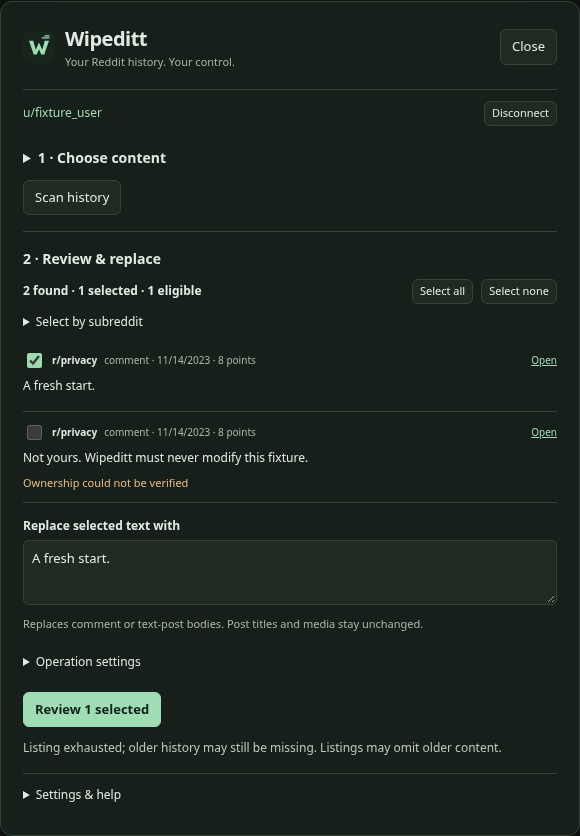

<p align="center"></p>

<p align="center">


</p>

**Your Reddit history. Your control.** Wipeditt helps you review and replace the bodies of your own comments and editable text posts. Created by **Rafael (rafaelolv)**. Runs in your browser, without a backend or telemetry.

**0.2.0 implements real OAuth authentication and Reddit API discovery/anonymization.** A registered Reddit **installed app** with access enabled for your use case is required. There is no shared Wipeditt Client ID. Reddit controls registration and approval; this project cannot create that permission by signing you in. The integration has been tested end-to-end with intercepted HTTP fixtures, **not a real authorized Reddit account**. Live deletion is intentionally unavailable pending separate validation.

## Install

Choose one distribution. All use the same engine and panel; no store publication is claimed.

| Distribution | Install |
| --- | --- |
| Userscript | Install [Tampermonkey](https://www.tampermonkey.net/) or [Violentmonkey](https://violentmonkey.github.io/), then open [wipeditt.user.js](https://raw.githubusercontent.com/rafelolv/Wipeditt/main/wipeditt.user.js). Accept Reddit-only request permissions. Actual manager/browser combinations remain unverified. |
| Chromium | Build locally, open `chrome://extensions`, enable Developer mode, choose **Load unpacked**, select `dist/chromium`. |
| Firefox | Build locally, open `about:debugging#/runtime/this-firefox`, choose **Load Temporary Add-on**, select `dist/firefox/manifest.json`. Unsigned temporary installs disappear on restart; Firefox runtime remains unverified. |

Open **[www.reddit.com](https://www.reddit.com/)** and click **Wipeditt**. The old.reddit.com launcher directs you to www for live work, keeping all operations under one origin lock. See [extension details](docs/EXTENSION.md).

## Connect Reddit

1. Click **Connect Reddit**. The dialog contains setup instructions.
2. If you have no registered app, open [Reddit app settings](https://www.reddit.com/prefs/apps). Create an **installed app** named Wipeditt and set its redirect URI to **`https://www.reddit.com/`**, including the trailing slash. If Reddit refuses creation or redirects to policy, follow its [API approval process](https://support.reddithelp.com/hc/en-us/articles/42728983564564-Responsible-Builder-Policy); do not use cookies or another app's credentials to bypass it.
3. Paste the **public Client ID**, shown below the app name, into Wipeditt. Do not enter a password, client secret or access token.
4. Choose **Sign in with Reddit**. Sign in on Reddit and approve the requested identity/history/read/edit permissions. Wipeditt verifies the returned account before enabling scans.

The Client ID can be remembered locally. Tokens stay in memory and expire after at most one hour. Disconnect, close the panel or reload to clear the token; reconnect when needed. Current flow and limitations: [Reddit integration](docs/REDDIT-INTEGRATION.md).

## Scan, review, replace

1. Choose **Comments**, **Text posts** or both, plus a maximum item count. Optional subreddit/date/text/regex/score/edited filters are under **Add filters**.
2. Click **Scan history**. Scanning never edits anything.
3. Review the list and deselect individual items, select all/none, or select by subreddit. Ineligible content cannot be selected.
4. Enter the exact replacement. Changing replacement updates this preview without fetching your history again; it invalidates any previous confirmation.
5. Click **Review N selected**. Check the account, count and exact text. Explicitly confirm; above 100 items type **ANONYMIZE**.
6. Watch progress. Pause/Resume work at request boundaries. Stop prevents new requests; submitted requests may finish. Export a local report from **Settings & help**.

<details><summary>Interface — actual Chromium capture using intercepted HTTP fixtures</summary>



</details>

## What ships

- A real installed-app OAuth code flow, consent popup, state validation, callback recovery without window.opener, memory-only token and account verification.
- Official API history pagination, normalized comments/self-post bodies, deduplication, cursor-loop/page guards and honest partial-history notices.
- Filtered review, own-account/ownership guards, expiring confirmation, exact custom replacement and read-after-write verification.
- Serial request pacing for authentication, reads, write guards and writes. Rate-limit headers, Retry-After, explicit body cooldowns, bounded retries and uncertain outcomes.
- A compact isolated panel, light/dark themes, keyboard focus, mobile layout, visual privacy masking and minimized local reports/checkpoints.
- A demo behind **Settings & help → Try demo data**, separate from normal account connection. Delete and Anonymize & Delete are demo-only.

| Target | Anonymization |
| --- | --- |
| Your comments | Replace body, when editable |
| Your text/self posts | Replace body, when editable |
| Titles | Cannot be edited |
| Image, video, gallery or link bodies | Not advertised as anonymizable |
| Archived, locked, removed or restricted content | Conservatively skipped or rejected by Reddit |
| Other authors | Never eligible |
| Chats/private messages | Unsupported |

Anonymization here means replacing visible text. **Archives, caches, moderation records and external copies can remain.** Changes can be permanent. Listings cannot guarantee complete account history. Deletion/combined mode remain unavailable for real accounts; an official data-export importer is planned.

## Request pacing and privacy

All HTTP calls are serialized, spaced by at least 1.5 seconds and subject to stricter server cooldowns. Writes are guarded again before dispatch and each explicit throttling retry. Authentication/permission failures stop processing. Ambiguous write timeouts/5xx/verification failures are **uncertain** and are never replayed automatically. See [Reddit limits](docs/REDDIT-LIMITS.md).

Requests go directly to `www.reddit.com` for token exchange and `oauth.reddit.com` for API work. No backend, analytics, tracking, remote configuration, fonts, CDN scripts or credential proxy. No cookie extraction or Reddit password collection. The userscript uses its manager's anonymous request API; extensions use a restricted broker that omits cookies. No automatic background jobs.

Scans are held in memory. Optional session checkpoints contain only IDs/states, a simulation flag and expiry. Reports omit original/replacement text, usernames, subreddit names and sensitive filter values. IDs can still be sensitive. Privacy mode masks the interface; it is not encryption. [Privacy details](docs/PRIVACY.md).

## Troubleshooting

- **Cannot create an app / policy redirect:** Reddit controls API registration and approval. Follow its access process. Wipeditt has no shared approved registration and does not bypass a denial.
- **Authorization refused:** check that the app type is installed, Client ID is correct, redirect URI matches exactly, and Reddit has enabled access for your app/use case.
- **Popup blocked / canceled:** allow the Reddit popup and reconnect; **Cancel sign-in** cancels the attempt.
- **Expired token / HTTP 401:** reconnect. Tokens are temporary and never persisted.
- **HTTP 403:** check app/account permissions; do not retry through alternative private endpoints.
- **Preview expired / filters changed:** scan again. Previews last five minutes, confirmation one minute. Changing only replacement/mode/scheduling does not extend preview lifetime.
- **Already running in another tab:** finish or stop that run. Live operations use a non-queued Web Lock on www.reddit.com.
- **Uncertain result:** check current content before attempting another change. Reports never count dispatch alone as success.

## Development and validation

Maintainer-authorized development requires Node.js 24+, npm, Python 3 and Chromium/Chrome. Build/test dependencies are locked; runtime dependencies are fully bundled.

```sh
npm ci
npx playwright-core install chromium
npm run build
npm run build:extensions
npm test
npm run test:ui
npm run check
```

Set `WIPEDITT_CHROME=/path/to/chrome` for icon generation/userscript checks and `WIPEDITT_EXTENSION_CHROME=/path/to/chromium` for extension-loading support. CI installs matching browsers on Ubuntu 24.04. Packages and SHA256SUMS appear in `dist/`.

The browser suite drives the **real OAuth/API code**, intercepting every HTTP response: consent redirect, code exchange, identity, listings, guarded edits and verification. It also loads the actual Chromium content script/background broker. This does **not** prove live Reddit, Firefox or userscript-manager compatibility. [Validation record](docs/VALIDATION.md), [architecture](docs/MAINTENANCE.md), [user guide](docs/USER-GUIDE.md), [release process](docs/RELEASING.md), [changelog](CHANGELOG.md).

## Ownership and credits

Copyright © 2026 **Rafael (rafaelolv)**. [Wipeditt Proprietary License](LICENSE): personal non-commercial use of official unmodified packages is allowed; modification, redistribution, commercial use and derivative software require prior written permission. This is not open source. The license protects original material, not abstract ideas or independently implemented functionality. [Licensing details](docs/LICENSING.md).

[Wipegram](https://github.com/rafelolv/Wipegram) and [Wipecord](https://github.com/rafelolv/Wipecord) informed engineering conventions. [Redact](https://redact.dev/services/reddit) informed workflow research. No platform-specific implementation was copied. Development tools retain their own licenses. Wipeditt is independent of Reddit and Redact.
